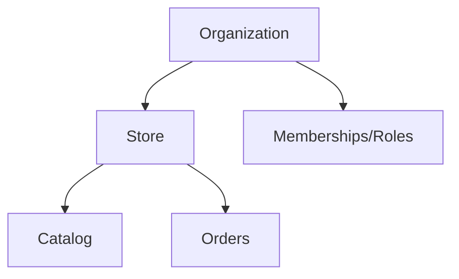

# Multi-Tenancy

- Tenant context derived from session + membership — never from client spoofable IDs alone.
- RLS policies enforce `store_id`/`organization_id`.
- Agencies: one org, many stores (MVP); cross-org later if needed.
