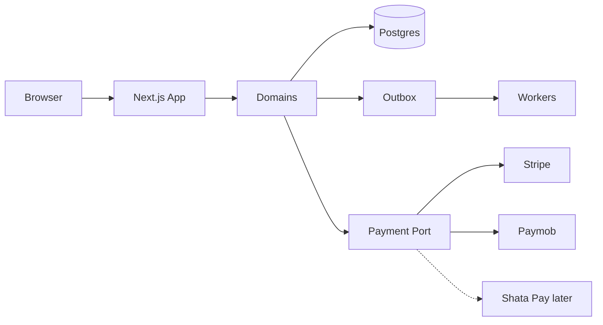

# System Overview

## Current (Verified `920c142`)
Next.js 16 App Router marketing + prototype: localStorage cart, dual cart APIs, dual product routes, Stripe scaffold, Supabase anon auth UI, no migrations. Evidence: [project-audit](../project-audit/).

## Target
Modular monolith (ADR-0003) with domain modules, Postgres/Supabase (ADR-0004), transactional outbox (ADR-0010), payment abstraction (ADR-0006).

## Extraction criteria
Extract a domain to a service only when team/scale/compliance demand it — not prematurely.
