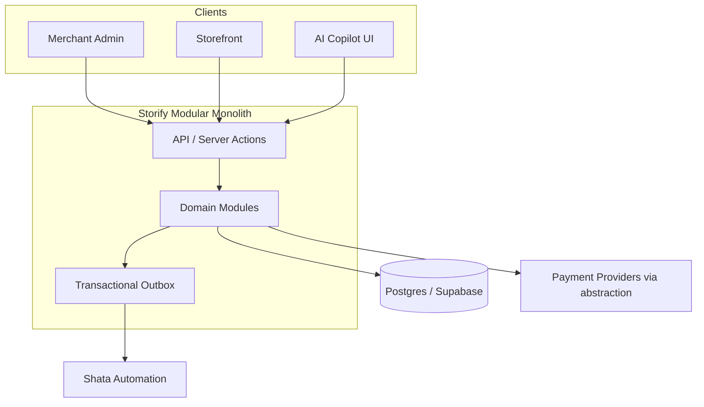

# Storify Master Plan

**Status:** Official  
**Established:** 2026-07-25  
**Application baseline (audit):** `920c142`  
**Preferred remote:** `shatasolutions/storify`

This is the canonical delivery plan. Specialized details live in linked docs. Agents must also obey [AGENTS.md](../../AGENTS.md).

---

## 1. Executive summary

Storify is an **AI-native, multi-tenant unified commerce platform** for businesses to create, launch, manage, automate, and grow sales channels in one system.  
**Promise:** Build and run your entire business through one conversation.  
**Beachhead:** Egypt & MENA (Arabic + English, regional payments, COD, WhatsApp).  
**Current repo (Verified):** polished Next.js marketing shell + thin commerce prototype — **~28% complete / ~8% production-ready** per [project-audit](../project-audit/). Build fails; security criticals open; no committed schema.

## 2. Current audited state

See [CURRENT_STATE.md](../status/CURRENT_STATE.md) and [STORIFY_AUDIT_REPORT.md](../project-audit/STORIFY_AUDIT_REPORT.md).

**Working (partial):** local cart reducer/debounce; single active Header via root layout; marketing homepage; static store UI; Stripe session scaffold; auth UI; success page.  
**Broken/missing:** nodemailer build break; unsigned webhook; IDOR APIs; client prices; dual `cart`/`carts`; dual `/product` vs `/store` detail; no migrations/RLS/tests/CI; no real AI; no merchant admin.

## 3–8. Product definition, positioning, customers, differentiation, principles, capabilities

- Definition & vision: [PRODUCT_VISION.md](../product/PRODUCT_VISION.md)
- PRD: [PRODUCT_REQUIREMENTS.md](../product/PRODUCT_REQUIREMENTS.md)
- Principles: [PRODUCT_PRINCIPLES.md](../product/PRODUCT_PRINCIPLES.md)
- Customers: [TARGET_CUSTOMERS.md](../product/TARGET_CUSTOMERS.md)
- Capabilities: [CAPABILITY_MAP.md](../product/CAPABILITY_MAP.md)
- Positioning: MENA merchants, social sellers, service businesses, brands, agencies needing AI-assisted ops + regional payments — **not** full Shopify clone day one.

## 9. Shata product boundaries

| System | Owns |
|--------|------|
| Storify | Merchants, orgs, stores, catalog, carts, checkout UX, orders, storefront, merchant AI surface, commerce analytics/APIs |
| Shata Pay | Payment adapters, intents, routing, reconciliation, refunds orchestration, payouts |
| Shata Automation | Workflow engine runtime |
| ShataGuard | Risk/security policy & AI governance |
| Ultimate Scraper | Import/extraction |
| Restaurant OS | Restaurant operations (future pack) |
| Codingo | Optional model/agent infra |

ADR-0009 · [DOMAIN_OWNERSHIP.md](../architecture/DOMAIN_OWNERSHIP.md)

## 10–16. Technical architecture

- Overview: [SYSTEM_OVERVIEW.md](../architecture/SYSTEM_OVERVIEW.md) — **modular monolith** + events
- Multi-tenancy: [MULTI_TENANCY.md](../architecture/MULTI_TENANCY.md)
- Data model: [DATA_MODEL.md](../architecture/DATA_MODEL.md)
- Routes: [ROUTE_MAP.md](../architecture/ROUTE_MAP.md) — canonical commerce detail `/store/[slug]`
- UI: single Header via root layout; no duplicate Layout chrome ([ADR-0011](../adr/ADR-0011-CANONICAL-ROUTES.md))
- AuthZ: [AUTHENTICATION_AUTHORIZATION.md](../architecture/AUTHENTICATION_AUTHORIZATION.md)
- Security: [SECURITY_MODEL.md](../security/SECURITY_MODEL.md)

## 17–26. Commerce domains

Catalog, inventory, pricing/discounts, cart, checkout, payments, orders, fulfillment, returns/refunds, customers — lifecycles in [COMMERCE_LIFECYCLES.md](../architecture/COMMERCE_LIFECYCLES.md).  
**Rule:** server-authoritative money (ADR-0005).  
Payments: secure Stripe in rescue; abstract for Shata Pay (ADR-0006) · [PAYMENT_ARCHITECTURE.md](../architecture/PAYMENT_ARCHITECTURE.md).

## 27–29. Merchant dashboard, storefront, theme builder

Phases 04–05 · [STOREFRONT_ARCHITECTURE.md](../architecture/STOREFRONT_ARCHITECTURE.md) · [THEME_BUILDER_ARCHITECTURE.md](../architecture/THEME_BUILDER_ARCHITECTURE.md) · ADR-0007.

## 30–31. Arabic/localization & MENA ops

First-class AR/EN + RTL; EGP/USD; COD; local providers; WhatsApp notifications — Phase 06 · ADR-0012.

## 32–35. AI architecture, employees, approvals, safety

[AI_ARCHITECTURE.md](../architecture/AI_ARCHITECTURE.md) · [AI_SECURITY.md](../security/AI_SECURITY.md) · ADR-0008.  
No unrestricted DB tools; no cross-merchant memory; high-risk actions require approval.

## 36–42. Automation, omnichannel, POS, B2B, developers, marketplace, buyer network, enterprise

Phases 08–13 · LONG_TERM_SCOPE · integration architecture.

## 43–47. Testing, CI/CD, deployment, observability, operations

[TESTING_STRATEGY.md](../engineering/TESTING_STRATEGY.md) · [CI_CD_STRATEGY.md](../engineering/CI_CD_STRATEGY.md) · [DEPLOYMENT_ARCHITECTURE.md](../architecture/DEPLOYMENT_ARCHITECTURE.md) · [operations/](../operations/)

## 48–50. KPIs, business model, risks

[KPI_FRAMEWORK.md](../product/KPI_FRAMEWORK.md) · [BUSINESS_MODEL.md](../product/BUSINESS_MODEL.md) · [RISKS.md](../status/RISKS.md)

## 51–52. Implementation phases & gates

Phases 00–13 in [execution/](../execution/) · [EXECUTION_ROADMAP.md](./EXECUTION_ROADMAP.md) · [PHASE_GATES.md](./PHASE_GATES.md) · [MVP_SCOPE.md](./MVP_SCOPE.md)

## 53. Definition of Done

[DEFINITION_OF_DONE.md](../engineering/DEFINITION_OF_DONE.md)

## 54. Immediate execution order

1. Finish Phase 00 (this OS) → docs:validate → local commit  
2. Phase 01: reproduce failures from `920c142`, then rescue/security only  
3. Do not start AI/POS/B2B early

## 55. Prohibited premature work

- Duplicate Header/cart/product-route/Supabase-client/schema concepts
- Real AI productization before commerce security foundations
- Unsigned webhooks / client prices in any “done” checkout
- Claiming production readiness without evidence

## 56. Final product vision

A globally extensible, MENA-first, AI-native commerce OS where merchants run physical, digital, services, and channel commerce—with AI employees using **permissioned tools**—while payments, automation, scraping, and restaurant ops integrate as Shata ecosystem capabilities without breaking Storify’s independent operability.
